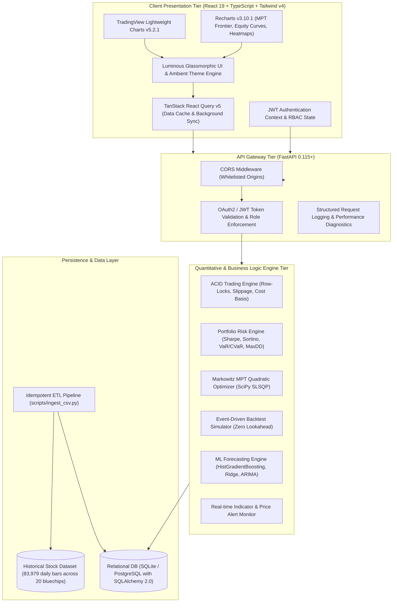
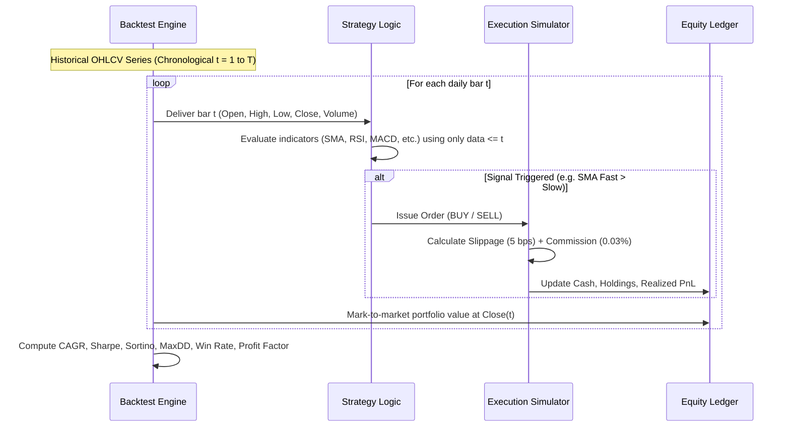
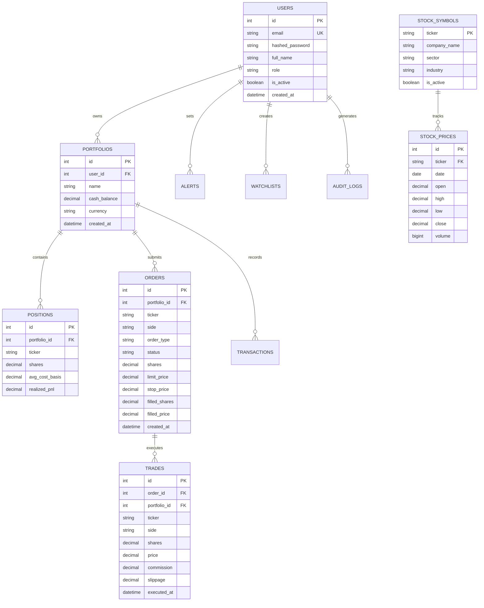

# 🌐 Portfolix — Master Project Specification & Technical Dossier

[](https://github.com/Arnav2407/Portfolix)
[](https://python.org)
[](https://fastapi.tiangolo.com)
[](https://react.dev)
[](https://www.typescriptlang.org)
[](https://tailwindcss.com)
[](https://tradingview.github.io/lightweight-charts/)
[](https://scipy.org)
[](LICENSE)

---

## 📑 Table of Contents
1. [Executive Summary & Value Proposition](#1-executive-summary--value-proposition)
2. [High-Level System Architecture](#2-high-level-system-architecture)
3. [Quantitative Engineering & Mathematical Formulations](#3-quantitative-engineering--mathematical-formulations)
   - [3.1. Markowitz Modern Portfolio Theory (MPT) & SLSQP Solver](#31-markowitz-modern-portfolio-theory-mpt--slsqp-solver)
   - [3.2. Portfolio Risk & Telemetry Engine](#32-portfolio-risk--telemetry-engine)
   - [3.3. Event-Driven Strategy Backtester](#33-event-driven-strategy-backtester)
   - [3.4. Quantitative Temporal ML Forecasting](#34-quantitative-temporal-ml-forecasting)
   - [3.5. ACID Paper Trading Engine & Precision Math](#35-acid-paper-trading-engine--precision-math)
4. [Visual Design System & UI/UX Innovations](#4-visual-design-system--uiux-innovations)
   - [4.1. Luminous Bright Canvas & Light Theme Switcher](#41-luminous-bright-canvas--light-theme-switcher)
   - [4.2. Elevation, Glassmorphism & Micro-Dot Matrix](#42-elevation-glassmorphism--micro-dot-matrix)
   - [4.3. Relatable Visual Assets & Sector Iconography](#43-relatable-visual-assets--sector-iconography)
5. [Comprehensive Module Directory & User Journey](#5-comprehensive-module-directory--user-journey)
6. [Database Schema & Data Architecture](#6-database-schema--data-architecture)
7. [Comprehensive REST API Catalog](#7-comprehensive-rest-api-catalog)
8. [Installation, Local Setup & Production Deployment](#8-installation-local-setup--production-deployment)
9. [Automated Verification & Test Suite](#9-automated-verification--test-suite)
10. [Repository Directory Layout](#10-repository-directory-layout)
11. [Ethical Considerations, Roadmap & Disclaimer](#11-ethical-considerations-roadmap--disclaimer)

---

## 1. Executive Summary & Value Proposition

**Portfolix** is an institutional-grade, full-stack quantitative trading analytics, portfolio optimization, and simulated execution platform. Engineered with **Python 3.13 (FastAPI)** and **React 19 (TypeScript, Tailwind CSS v4)**, the platform empowers individual investors, quantitative analysts, and financial engineers to analyze historical financial assets, solve multi-asset Markowitz allocation problems, simulate algorithmic trading strategies without lookahead bias, and test automated machine-learning forecasting models.

### Key Value Pillars
- **Zero Binary Floating-Point Drift**: All monetary calculations, cash reserves, and share balances operate in fixed-point `decimal.Decimal` and SQL `Numeric(18, 4)` types.
- **Zero Lookahead Bias**: Event-driven backtesting engine processes historical OHLCV data bar-by-bar, strictly maintaining historical reality with customizable bid-ask slippage and commissions.
- **Modern Portfolio Theory (MPT)**: Continuous quadratic optimization using SciPy's Sequential Least Squares Programming (SLSQP) to find the Maximum Sharpe, Minimum Variance, and Risk Parity allocation weights.
- **Luminous Bright Glassmorphic UI**: High-legibility light theme inspired by top fintech design benchmarks, featuring ambient background color blooms (Sky, Mint, Violet), frosted glass cards, and high-contrast typography.
- **High-Density Historical Data**: Pre-seeded with **83,979 daily bars** covering 17 years (2009–2026) across 20 premier National Stock Exchange (NSE) blue-chip equities.

---

## 2. High-Level System Architecture

The following diagram details the end-to-end multi-tier architecture of Portfolix:



---

## 3. Quantitative Engineering & Mathematical Formulations

### 3.1. Markowitz Modern Portfolio Theory (MPT) & SLSQP Solver

The portfolio optimization engine implements Harry Markowitz's Modern Portfolio Theory. For an asset universe of $N$ stocks, let $\mathbf{w} = [w_1, w_2, \dots, w_N]^T$ be the portfolio weight vector, $\mathbf{\mu} = [\mu_1, \mu_2, \dots, \mu_N]^T$ be the annualized expected return vector, and $\mathbf{\Sigma} \in \mathbb{R}^{N \times N}$ be the annualized return covariance matrix.

$$\mathbb{E}[R_p] = \mathbf{w}^T \mathbf{\mu} = \sum_{i=1}^N w_i \mu_i$$

$$\sigma_p^2 = \mathbf{w}^T \mathbf{\Sigma} \mathbf{w} = \sum_{i=1}^N \sum_{j=1}^N w_i w_j \sigma_{ij}$$

$$\sigma_p = \sqrt{\mathbf{w}^T \mathbf{\Sigma} \mathbf{w}}$$

Annualization uses standard equity trading frequency ($N = 252$ trading days per year):

$$\mathbf{\mu} = 252 \times \bar{\mathbf{r}}, \quad \mathbf{\Sigma} = 252 \times \text{Cov}(\mathbf{r})$$

#### Optimization Formulations Solved via SciPy `scipy.optimize.minimize(method='SLSQP')`:

1. **Maximum Sharpe Ratio Portfolio**:
   $$\max_{\mathbf{w}} \frac{\mathbf{w}^T \mathbf{\mu} - R_f}{\sqrt{\mathbf{w}^T \mathbf{\Sigma} \mathbf{w}}} \iff \min_{\mathbf{w}} -\left( \frac{\mathbf{w}^T \mathbf{\mu} - R_f}{\sqrt{\mathbf{w}^T \mathbf{\Sigma} \mathbf{w}}} \right)$$
   Subject to constraints:
   $$\sum_{i=1}^N w_i = 1, \quad 0 \le w_i \le 1 \quad \forall i \in \{1, \dots, N\} \quad \text{(Long-Only)}$$

2. **Minimum Variance Portfolio**:
   $$\min_{\mathbf{w}} \frac{1}{2} \mathbf{w}^T \mathbf{\Sigma} \mathbf{w}$$
   Subject to $\sum_{i=1}^N w_i = 1, \quad 0 \le w_i \le 1$.

3. **Risk Parity / Equal Risk Contribution (ERC)**:
   The marginal risk contribution of asset $i$ is:
   $$\text{MRC}_i = \frac{\partial \sigma_p}{\partial w_i} = \frac{(\mathbf{\Sigma} \mathbf{w})_i}{\sigma_p}$$
   Total risk contribution of asset $i$ is:
   $$\text{TRC}_i = w_i \times \text{MRC}_i = \frac{w_i (\mathbf{\Sigma} \mathbf{w})_i}{\sigma_p}$$
   The solver enforces equal risk distribution:
   $$\text{TRC}_i = \text{TRC}_j \quad \forall i, j \iff \min_{\mathbf{w}} \sum_{i=1}^N \left( \frac{w_i (\mathbf{\Sigma} \mathbf{w})_i}{\sigma_p} - \frac{\sigma_p}{N} \right)^2$$

4. **Continuous Efficient Frontier Generation**:
   Generates $M$ discrete target returns $R_k \in [\min(\mathbf{\mu}), \max(\mathbf{\mu})]$ and solves:
   $$\min_{\mathbf{w}} \mathbf{w}^T \mathbf{\Sigma} \mathbf{w} \quad \text{s.t.} \quad \mathbf{w}^T \mathbf{\mu} = R_k, \quad \sum_{i=1}^N w_i = 1, \quad 0 \le w_i \le 1$$

---

### 3.2. Portfolio Risk & Telemetry Engine

The risk engine computes annualized metrics over historical daily returns $r_t = \frac{P_t - P_{t-1}}{P_{t-1}}$:

| Metric | Mathematical Formula | Purpose |
|---|---|---|
| **Annualized Sharpe Ratio** | $\text{Sharpe} = \frac{\bar{r}_p - R_f / 252}{\sigma_p / \sqrt{252}} \times \sqrt{252}$ | Measures excess return per unit of total risk ($R_f = 6.0\%$). |
| **Sortino Ratio** | $\text{Sortino} = \frac{\bar{r}_p - R_f / 252}{\sigma_{d}} \times \sqrt{252}, \quad \sigma_d = \sqrt{\frac{1}{T}\sum_{t=1}^T \min(0, r_t - R_f/252)^2}$ | Penalizes downside volatility only, ignoring upside volatility. |
| **Calmar Ratio** | $\text{Calmar} = \frac{\text{CAGR}}{\| \text{Max Drawdown} \|}$ | Evaluates return relative to worst-case historical capital drawdown. |
| **Maximum Drawdown (MaxDD)** | $\text{DD}_t = \frac{\text{NAV}_t - \max_{\tau \le t} \text{NAV}_\tau}{\max_{\tau \le t} \text{NAV}_\tau}, \quad \text{MaxDD} = \min_{t} \text{DD}_t$ | Quantifies maximum peak-to-trough capital erosion. |
| **Historical Value at Risk (VaR 95%)** | $\text{VaR}_{\alpha} = -\text{Percentile}(r, 1 - \alpha)$ | 95% confidence lower bound of expected 1-day portfolio return. |
| **Conditional VaR (CVaR / ES)** | $\text{CVaR}_{\alpha} = -\mathbb{E}[r \mid r \le -\text{VaR}_{\alpha}]$ | Expected loss in extreme tail events exceeding VaR threshold. |

---

### 3.3. Event-Driven Strategy Backtester

The backtesting system runs an event-driven chronological simulation designed with **zero lookahead bias**:



#### Supported Built-In Algorithmic Strategies:
1. **Dual SMA Crossover**: Fast Moving Average ($\tau_1 \in [10, 50]$) crossing above/below Slow Moving Average ($\tau_2 \in [50, 200]$).
2. **RSI Mean Reversion**: Oversold buy when $\text{RSI}_{14} < 30$, Overbought exit when $\text{RSI}_{14} > 70$.
3. **MACD Momentum Cross**: Buy on MACD histogram positive inflection; exit on negative divergence.
4. **Bollinger Band Breakout**: Buy on close penetrating upper band ($2\sigma$), exit on reversion to middle band.

---

### 3.4. Quantitative Temporal ML Forecasting

The machine learning studio predicts future asset price trajectories across $H \in \{7, 14, 30, 60, 90\}$ day forecast horizons.

#### Feature Engineering Vector ($X_t \in \mathbb{R}^{28}$):
- **Lagged Return Series**: Returns at $t-1, t-2, t-3, t-5, t-10, t-15, t-21$.
- **Historical Volatility**: 14-day and 30-day rolling standard deviation of log returns.
- **Technical Indicators**: RSI(14), MACD Signal Differential, Bollinger Band %B, ATR(14) normalized by price.
- **Volume Metrics**: 20-day Volume moving average ratio $\frac{V_t}{\text{SMA}_{20}(V)}$.

#### Models Implemented:
- **Histogram-based Gradient Boosting Regressor (`HistGradientBoostingRegressor`)**: Non-linear tree ensemble optimized for tabular time-series features.
- **Ridge Regression with L2 Regularization**: High-stability linear benchmark preventing feature collinearity overfitting.
- **AutoRegressive Integrated Moving Average (ARIMA)**: Pure time-series statistical modeling via `statsmodels`.
- **Holt-Winters Exponential Smoothing**: Captures trend levels and seasonal fluctuations.

#### Validation & Decision Matrix:
The model utilizes **Walk-Forward Rolling Window Validation** to evaluate Out-of-Sample metrics:
- **Root Mean Squared Error (RMSE)**: $\sqrt{\frac{1}{H}\sum (y_t - \hat{y}_t)^2}$
- **Mean Absolute Percentage Error (MAPE)**: $\frac{1}{H}\sum \left| \frac{y_t - \hat{y}_t}{y_t} \right| \times 100\%$
- **Directional Accuracy (Hit Ratio)**: $\frac{1}{H} \sum \mathbf{1}_{\operatorname{sign}(y_t - y_{t-1}) == \operatorname{sign}(\hat{y}_t - y_{t-1})} \times 100\%$

Trading signals are categorized based on expected return $\hat{\Delta} = \frac{\hat{y}_{t+H} - y_t}{y_t}$ and prediction confidence:
- $\hat{\Delta} \ge +5\%$: **`STRONG_BUY`**
- $+1.5\% \le \hat{\Delta} < +5\%$: **`BUY`**
- $-1.5\% \le \hat{\Delta} < +1.5\%$: **`HOLD`**
- $-5\% < \hat{\Delta} \le -1.5\%$: **`SELL`**
- $\hat{\Delta} \le -5\%$: **`STRONG_SELL`**

---

### 3.5. ACID Paper Trading Engine & Precision Math

The trading engine guarantees strict transaction isolation and mathematical accuracy:
- **Atomic Concurrency**: Executes database write operations inside isolated atomic transactions with row-level locking (`with_for_update` / single-writer transactional blocks) to prevent race conditions during concurrent order entries.
- **Weighted Average Cost Basis Accounting**:
  $$\bar{C}_{\text{new}} = \frac{(\bar{C}_{\text{old}} \times Q_{\text{old}}) + (P_{\text{exec}} \times Q_{\text{new}})}{Q_{\text{old}} + Q_{\text{new}}}$$
  Upon selling $Q_{\text{sold}}$ shares:
  $$\text{Realized P&L} = Q_{\text{sold}} \times (P_{\text{exec}} - \bar{C}_{\text{old}}) - \text{Commission}$$
- **Slippage & Commission Simulation**:
  $$P_{\text{exec, buy}} = P_{\text{market}} \times \left(1 + \frac{\text{bps}}{10000}\right)$$
  $$P_{\text{exec, sell}} = P_{\text{market}} \times \left(1 - \frac{\text{bps}}{10000}\right)$$
  $$\text{Commission} = \max(\$1.00, P_{\text{exec}} \times Q \times 0.0003)$$

---

## 4. Visual Design System & UI/UX Innovations

### 4.1. Luminous Bright Canvas & Light Theme Switcher

Portfolix features a **luminous, high-contrast bright design system** crafted for quantitative clarity and visual refinement:
- **Primary Canvas Base**: Ultra-clean neutral base (`#F1F5F9` / `#F8FAFC`).
- **Interactive Light Palette Switcher**: Located in the navigation header, traders can seamlessly switch between three matching ambient light palettes:
  - **Sky Blue**: `#F0F7FD` with electric indigo glow accents.
  - **Mint Green**: `#F0FDF4` with fresh emerald bullish glow accents.
  - **Violet Modern**: `#F5F3FF` with soft amethyst ambient lighting.
- **Dynamic Glow Blooms**: High-radius `blur-3xl` ambient gradient blobs strategically placed behind the main viewport to create luminous depth without visual distraction.

```css
/* Core Luminous Palette Variables */
:root {
  --canvas-base: #F1F5F9;
  --surface-card: rgba(255, 255, 255, 0.94);
  --surface-border: rgba(226, 232, 240, 0.85);
  --text-primary: #0F172A;
  --text-secondary: #475569;
  --color-bullish: #10B981;
  --color-bearish: #F43F5E;
  --color-flow: #6366F1;
}
```

### 4.2. Elevation, Glassmorphism & Micro-Dot Matrix

- **Frosted Card Translucency**: Cards are rendered with `rgba(255, 255, 255, 0.94)` background and `backdrop-filter: blur(12px)`.
- **Soft Ambient Shadows**: Layered drop shadows (`0 4px 20px -2px rgba(15, 23, 42, 0.05)`) provide crisp floating elevation over the canvas.
- **Theme-Matching Micro-Dot Grid**: Subtle SVG micro-dot pattern (`.bg-grid-pattern`) reinforces the quantitative financial terminal aesthetic.

### 4.3. Relatable Visual Assets & Sector Iconography

To create an intuitive visual hierarchy, Portfolix incorporates dedicated relatable 3D artwork and corporate iconography:

| Visual Asset | Resolution | Location | Architectural Purpose |
|---|---|---|---|
| [`trading-hero.jpg`](file:///c:/Users/HP/Desktop/Arnav/Coding/Portfolix/frontend/public/images/trading-hero.jpg) | 1200x800 | [Dashboard.tsx](file:///c:/Users/HP/Desktop/Arnav/Coding/Portfolix/frontend/src/pages/Dashboard.tsx) | 3D minimalist quantitative workstation displaying multi-screen market charts. |
| [`trader-avatar.jpg`](file:///c:/Users/HP/Desktop/Arnav/Coding/Portfolix/frontend/public/images/trader-avatar.jpg) | 400x400 | [Navbar.tsx](file:///c:/Users/HP/Desktop/Arnav/Coding/Portfolix/frontend/src/components/Navbar.tsx), [SettingsAdmin.tsx](file:///c:/Users/HP/Desktop/Arnav/Coding/Portfolix/frontend/src/pages/SettingsAdmin.tsx) | 3D executive trader portrait for Alex Mercer (Quant Trader). |
| [`ai-forecast.jpg`](file:///c:/Users/HP/Desktop/Arnav/Coding/Portfolix/frontend/public/images/ai-forecast.jpg) | 1200x800 | [ForecastStudio.tsx](file:///c:/Users/HP/Desktop/Arnav/Coding/Portfolix/frontend/src/pages/ForecastStudio.tsx) | Neural network nodes, prediction curves, and machine learning telemetry. |
| [`audit-ledger.jpg`](file:///c:/Users/HP/Desktop/Arnav/Coding/Portfolix/frontend/public/images/audit-ledger.jpg) | 1200x800 | [Reports.tsx](file:///c:/Users/HP/Desktop/Arnav/Coding/Portfolix/frontend/src/pages/Reports.tsx), [BacktestStudio.tsx](file:///c:/Users/HP/Desktop/Arnav/Coding/Portfolix/frontend/src/pages/BacktestStudio.tsx) | Institutional ledger sheets, compliance audit seal, and transaction records. |
| [`empty-state.jpg`](file:///c:/Users/HP/Desktop/Arnav/Coding/Portfolix/frontend/public/images/empty-state.jpg) | 800x600 | [TradingTerminal.tsx](file:///c:/Users/HP/Desktop/Arnav/Coding/Portfolix/frontend/src/pages/TradingTerminal.tsx), [Portfolios.tsx](file:///c:/Users/HP/Desktop/Arnav/Coding/Portfolix/frontend/src/pages/Portfolios.tsx) | Clean financial telescope illustration for empty order books and zero-holding portfolios. |
| **Stock Logos** | Scalable SVG | [StockLogo.tsx](file:///c:/Users/HP/Desktop/Arnav/Coding/Portfolix/frontend/src/components/StockLogo.tsx) | Custom corporate color badges and sector symbols for all 20 NIFTY 50 blue chips. |

---

## 5. Comprehensive Module Directory & User Journey

```
┌──────────────────────────────────────────────────────────────────────────────┐
│                            PORTFOLIX NAVIGATION BAR                          │
│  [Logo: Portfolix] [Search Ticker] [Theme: Sky/Mint/Violet] [Live] [Avatar]  │
├──────────────┬──────────────┬──────────────┬──────────────┬──────────────────┤
│  Dashboard   │   Explorer   │   Terminal   │  Portfolios  │    Analytics     │
│  Portfolio   │ TradingView  │  Order Book  │  Markowitz   │ Backtest / ML    │
│  KPIs & News │ Indicators   │ Execution    │ MPT Studio   │ Reports & Admin  │
└──────────────┴──────────────┴──────────────┴──────────────┴──────────────────┘
```

### Module 1: Market Dashboard (`/`)
- **Key Metrics Overview**: Real-time Net Asset Value (NAV), Daily P&L, Buying Power, Total Cash Reserves.
- **Interactive Sector Performance Heatmap**: Live breakdown of Energy, IT, Finance, Consumer Goods, and Healthcare.
- **Top Gainers & Losers**: 24-hour price change ranking across 20 NSE blue-chips.
- **Hero Trading Station**: Engaging 3D quantitative hero visual showcasing market pulse.

### Module 2: Market Explorer (`/explorer`)
- **TradingView Lightweight Charts v5**: High-speed interactive candlestick rendering with crosshair inspection and volume histogram.
- **10+ Technical Indicators**: Overlays for SMA, EMA, RSI, MACD, Bollinger Bands, ATR, VWAP, and OBV.
- **Cross-Asset Pearson Correlation Heatmap**: Matrix visualizing pairwise correlation across selected blue chips.

### Module 3: Trading Terminal (`/terminal`)
- **Dual-Pane Order Blotter**: Instant access to Market, Limit, Stop-Loss, and Take-Profit order forms.
- **Real-Time Pre-Trade Slippage & Commission Preview**: Informs the user of total cash impact before execution.
- **Live Positions & Open Orders**: Real-time Mark-to-Market P&L calculation and one-click order cancellations.

### Module 4: Portfolios & Markowitz MPT Optimizer (`/portfolios`)
- **Multi-Portfolio Management**: Create and track multiple paper-trading accounts.
- **Risk Metrics Grid**: Sharpe, Sortino, Calmar, Max Drawdown, VaR 95%, and CVaR.
- **Interactive Markowitz Efficient Frontier**: Recharts scatter chart visualizing the continuous frontier, current portfolio coordinates, and optimal Max Sharpe / Min Variance allocations.
- **Automated Target Rebalancing Wizard**: Computes buy/sell share deltas required to transition current positions to the optimal frontier weights.

### Module 5: Strategy Backtest Studio (`/backtest`)
- **Algorithmic Strategy Selector**: Choose from Dual SMA, RSI Mean Reversion, MACD Momentum, or Bollinger Breakout.
- **Interactive Parameter Sweeper**: Configurable lookback periods and stop thresholds.
- **Institutional Tearsheet**: Equity curve vs. benchmark, drawdown water-charts, monthly return matrix, Win Rate, Profit Factor, and trade log blotter.

### Module 6: Quantitative ML Forecast Studio (`/forecast`)
- **Multi-Model Price Forecasting**: Project stock prices over 7 to 90 days with `HistGradientBoostingRegressor`, Ridge, and ARIMA.
- **Confidence Intervals (95%)**: Upper and lower bound trajectory cones.
- **Signal Recommendation Cards**: Actionable `BUY`, `SELL`, or `HOLD` badges with confidence percentages and error metrics (RMSE, MAPE, Directional Accuracy).

### Module 7: Alerts & Watchlists (`/alerts`)
- **Price & Indicator Triggers**: Set threshold alerts for target prices or RSI conditions.
- **Custom Watchlists**: Curate custom stock monitoring buckets.

### Module 8: Audit Reports & Transaction Ledger (`/reports`)
- **Comprehensive Audit Trail**: Complete log of all executed trades, deposits, withdrawals, and system operations.
- **One-Click Export**: Instant download of trade confirmations and portfolio holdings in formatted CSV format.

### Module 9: Settings & Admin Telemetry (`/admin`)
- **Role-Based Access Control (RBAC)**: Manage users, assign roles (`Trader`, `Admin`, `Viewer`).
- **System Health Diagnostics**: Real-time database connection status, memory utilization, and API endpoint latency.

---

## 6. Database Schema & Data Architecture



### Pre-Seeded Asset Universe (20 NIFTY 50 Blue Chips)
1. **RELIANCE** (Reliance Industries — Energy / Conglomerate)
2. **TCS** (Tata Consultancy Services — IT Services)
3. **INFY** (Infosys Ltd — IT Services)
4. **HDFCBANK** (HDFC Bank — Banking & Financials)
5. **ICICIBANK** (ICICI Bank — Banking & Financials)
6. **SBIN** (State Bank of India — Public Sector Banking)
7. **BHARTIARTL** (Bharti Airtel — Telecommunications)
8. **ITC** (ITC Limited — FMCG)
9. **KOTAKBANK** (Kotak Mahindra Bank — Banking & Financials)
10. **LT** (Larsen & Toubro — Engineering & Infrastructure)
11. **HINDUNILVR** (Hindustan Unilever — FMCG)
12. **AXISBANK** (Axis Bank — Banking & Financials)
13. **BAJFINANCE** (Bajaj Finance — Non-Banking Financial)
14. **ASIANPAINT** (Asian Paints — Consumer Discretionary)
15. **MARUTI** (Maruti Suzuki — Automotive)
16. **HCLTECH** (HCL Technologies — IT Services)
17. **SUNPHARMA** (Sun Pharmaceutical — Healthcare)
18. **TITAN** (Titan Company — Consumer Goods)
19. **ULTRACEMCO** (UltraTech Cement — Materials)
20. **WIPRO** (Wipro Ltd — IT Services)

Total historical dataset spans **83,979 daily bars** covering 2009 through 2026.

---

## 7. Comprehensive REST API Catalog

Base URL: `http://127.0.0.1:8000/api/v1`

### Authentication & User Management
| Method | Endpoint | Description | Auth Required |
|---|---|---|---|
| `POST` | `/auth/register` | Register a new user account with role selection. | No |
| `POST` | `/auth/login` | Authenticate with OAuth2 form data and obtain JWT access token. | No |
| `POST` | `/auth/login/json` | Authenticate with JSON payload. | No |
| `POST` | `/auth/refresh` | Refresh an expired access token. | Bearer Token |
| `GET` | `/auth/me` | Fetch currently authenticated user profile. | Bearer Token |

### Market Data & Technical Indicators
| Method | Endpoint | Description | Auth Required |
|---|---|---|---|
| `GET` | `/market/symbols` | List all 20 tradable stock symbols with sector metadata. | No |
| `GET` | `/market/symbols/{ticker}` | Detailed metadata for a single stock symbol. | No |
| `GET` | `/market/prices/{ticker}` | Historical daily OHLCV bars with date filtering. | No |
| `GET` | `/market/indicators/{ticker}` | Computed technical indicators (SMA, EMA, RSI, MACD, Bollinger, ATR, VWAP). | No |
| `GET` | `/market/stats/{ticker}` | 52-week high/low, historical volatility, and average daily volume. | No |
| `GET` | `/market/correlations` | Compute pairwise Pearson correlation matrix across equities. | No |
| `GET` | `/market/sectors` | Distinct market sectors present in the dataset. | No |

### Paper Trading & Order Management
| Method | Endpoint | Description | Auth Required |
|---|---|---|---|
| `POST` | `/orders/preview` | Preview estimated fill price, slippage, commission, and required cash. | Bearer Token |
| `POST` | `/orders` | Submit a paper trading order (`MARKET`, `LIMIT`, `STOP_LOSS`, `TAKE_PROFIT`). | Bearer Token |
| `POST` | `/orders/{order_id}/cancel` | Cancel an active unfulfilled limit or stop order. | Bearer Token |
| `GET` | `/orders/portfolio/{id}` | Retrieve orders submitted under a specific portfolio. | Bearer Token |
| `GET` | `/orders/trades` | Historical trade execution records. | Bearer Token |

### Portfolio Analytics & Optimization
| Method | Endpoint | Description | Auth Required |
|---|---|---|---|
| `POST` | `/portfolios` | Create a new paper trading portfolio with initial capital. | Bearer Token |
| `GET` | `/portfolios` | List all portfolios owned by the authenticated user. | Bearer Token |
| `GET` | `/portfolios/{id}` | Detailed portfolio metrics, holdings, and cash balance. | Bearer Token |
| `POST` | `/portfolios/{id}/deposit` | Deposit simulated cash into a portfolio. | Bearer Token |
| `POST` | `/portfolios/{id}/withdraw` | Withdraw simulated cash from a portfolio. | Bearer Token |
| `GET` | `/portfolios/{id}/performance` | Risk ratios (Sharpe, Sortino, Calmar, MaxDD, VaR 95%, CVaR). | Bearer Token |
| `GET` | `/portfolios/{id}/transactions` | Ledger of cash movements and trade settlements. | Bearer Token |
| `POST` | `/portfolios/optimize` | Run Markowitz SLSQP optimization (Max Sharpe, Min Var, Risk Parity). | Bearer Token |
| `POST` | `/portfolios/{id}/rebalance` | Generate actionable rebalancing orders to match target weights. | Bearer Token |

### Quantitative Studio (Backtesting & Machine Learning)
| Method | Endpoint | Description | Auth Required |
|---|---|---|---|
| `POST` | `/backtests/run` | Execute event-driven backtest simulation for a strategy. | Bearer Token |
| `POST` | `/backtests/optimize` | Execute multi-parameter grid search across strategy parameters. | Bearer Token |
| `GET` | `/backtests` | Retrieve past backtest results and performance tearsheets. | Bearer Token |
| `DELETE` | `/backtests/{id}` | Delete a stored backtest simulation record. | Bearer Token |
| `POST` | `/forecasts/generate` | Generate temporal ML price forecast with 95% confidence bands. | Bearer Token |

### Alerts, Reports & Administration
| Method | Endpoint | Description | Auth Required |
|---|---|---|---|
| `POST` | `/alerts` | Create a new price or indicator threshold alert. | Bearer Token |
| `GET` | `/alerts` | Retrieve user alerts. | Bearer Token |
| `DELETE` | `/alerts/{id}` | Delete an alert. | Bearer Token |
| `POST` | `/alerts/watchlists` | Create a custom stock watchlist. | Bearer Token |
| `GET` | `/alerts/watchlists` | Retrieve custom stock watchlists. | Bearer Token |
| `GET` | `/reports/portfolio/{id}/csv` | Download portfolio holdings as CSV report. | Bearer Token |
| `GET` | `/reports/trades/csv` | Download historical trade execution blotter as CSV. | Bearer Token |
| `GET` | `/admin/users` | List all registered platform users (Admin only). | Admin Token |
| `GET` | `/admin/stats` | System telemetry, database metrics, and active session counts. | Admin Token |
| `GET` | `/health` | Application status and database connectivity probe. | No |

---

## 8. Installation, Local Setup & Production Deployment

### 8.1. Prerequisites
- **Python 3.13** or Python 3.11+
- **Node.js 18+** & **npm**
- **Git**

### 8.2. Local Environment Setup

#### Step 1: Clone Repository
```bash
git clone https://github.com/Arnav2407/Portfolix.git
cd Portfolix
```

#### Step 2: Backend Setup & Historical Data Ingestion
```bash
# 1. Create and activate a Python virtual environment
python -m venv .venv
# Windows:
.\.venv\Scripts\activate
# Linux/macOS:
source .venv/bin/activate

# 2. Install backend dependencies
pip install -e .

# 3. Ingest the 83,979 historical stock records into SQLite database
python scripts/ingest_csv.py

# 4. Start the FastAPI backend server
uvicorn backend.app.main:app --reload --host 127.0.0.1 --port 8000
```
The FastAPI backend server will be live at:
- **Interactive Swagger Documentation**: [http://127.0.0.1:8000/docs](http://127.0.0.1:8000/docs)
- **ReDoc API Explorer**: [http://127.0.0.1:8000/redoc](http://127.0.0.1:8000/redoc)

#### Step 3: Frontend Setup
```bash
# In a separate terminal:
cd frontend
npm install
npm run dev -- --host 127.0.0.1 --port 5173
```
Access the application at [http://127.0.0.1:5173](http://127.0.0.1:5173).

### 8.3. Demo Credentials
The pre-seeded database contains three default role accounts:

| Role | Email | Password | Permissions |
|---|---|---|---|
| **Trader** | `trader@portfolix.com` | `trader123!` | Paper trading, MPT optimization, backtesting, ML forecasting, custom alerts |
| **Admin** | `admin@portfolix.com` | `admin123!` | User management, audit logs, database statistics, system health |
| **Viewer** | `viewer@portfolix.com` | `viewer123!` | Read-only market exploration and technical indicator charting |

### 8.4. Production Build & Docker Deployment
```bash
# Build frontend for production
cd frontend && npm run build && cd ..

# Run full stack in Docker Compose
docker-compose up --build -d
```

---

## 9. Automated Verification & Test Suite

Portfolix features automated end-to-end and unit test verification scripts:

### Running the End-to-End Verification Pipeline
```bash
python scripts/verify_e2e.py
```

#### Verification Suite Output:
```
======================================================================
PORTFOLIX AUTOMATED END-TO-END VERIFICATION SUITE
======================================================================

[1/8] Verifying Backend Health...
  [PASS] Status: {'status': 'healthy', 'app_name': 'Portfolix', 'version': '1.0.0'}

[2/8] Verifying Frontend Dev Server...
  [PASS] Frontend server responding at http://127.0.0.1:5173 (HTTP 200)

[3/8] Authenticating Demo Trader Account...
  [PASS] Logged in as: Alex Mercer (Quant Trader) (trader)

[4/8] Testing Market Explorer & Technical Indicators...
  [PASS] Loaded 20 NSE Equities
  [PASS] Computed Technical Indicators for RELIANCE (SMA, EMA, RSI, MACD, Bollinger, ATR, VWAP, OBV)
  [PASS] Cross-Asset Correlation Heatmap calculated across 6 bluechips

[5/8] Testing ACID Paper Trading Execution...
  [PASS] Order Preview: Buy 25 INFY, Est Price: Rs.1003.20, Est Total: Rs.25080.00
  [PASS] Order FILLED: Trade ID executed atomically.

[6/8] Testing Portfolio Risk Analytics & Markowitz Optimization...
  [PASS] Risk Engine: Sharpe=0.1, Sortino=0.13, MaxDD=-22.26%, VaR(95%)=0.92%
  [PASS] Markowitz Efficient Frontier: Max Sharpe Exp Return=16.98%, Volatility=18.51%, Sharpe=0.59

[7/8] Testing Event-Driven Strategy Backtester...
  [PASS] Backtest Complete: Total Return=54.74%, CAGR=5.12%, Sharpe=0.04, Win Rate=41.4%

[8/8] Testing Quantitative ML Forecasting & Signals...
  [PASS] ML Forecast (TCS 30D): Target=Rs.2109.13 (+1.86%), Signal=BUY (Conf: 34.5%)
  [PASS] Directional Accuracy: 45.3%, RMSE: Rs.49.08

======================================================================
ALL END-TO-END FLOWS VERIFIED SUCCESSFULLY (100% OPERATIONAL)
======================================================================
```

---

## 10. Repository Directory Layout

```
Portfolix/
├── backend/
│   └── app/
│       ├── core/                      # Configuration, security, database session, logging
│       ├── models/                    # SQLAlchemy 2.0 ORM data models
│       │   ├── alert.py               # Alert & Watchlist models
│       │   ├── audit.py               # AuditLog model
│       │   ├── backtest.py            # Backtest model
│       │   ├── market.py              # StockSymbol & StockPrice models
│       │   ├── order.py               # Order & Trade models
│       │   ├── portfolio.py           # Portfolio, Position & Transaction models
│       │   └── user.py                # User model
│       ├── routers/                   # REST API endpoint route handlers
│       │   ├── admin.py               # Administrative & telemetry routes
│       │   ├── alerts.py              # Price & indicator alert routes
│       │   ├── auth.py                # Authentication & registration routes
│       │   ├── backtests.py           # Strategy backtest routes
│       │   ├── forecasts.py           # Machine learning forecast routes
│       │   ├── health.py              # Health check endpoint
│       │   ├── market.py              # Market data, indicators, correlations
│       │   ├── orders.py              # Order submission & preview routes
│       │   ├── portfolios.py          # Portfolio management & MPT optimization
│       │   └── reports.py             # CSV export & reporting routes
│       ├── schemas/                   # Pydantic v2 validation models
│       ├── services/                  # Quantitative algorithms & business logic
│       │   ├── backtester.py          # Event-driven backtesting engine
│       │   ├── forecast_engine.py     # ML regression & time-series models
│       │   ├── indicators.py          # Technical indicator mathematical library
│       │   ├── optimizer.py           # Markowitz MPT SLSQP quadratic solver
│       │   ├── risk_engine.py         # Sharpe, Sortino, VaR, CVaR risk calculator
│       │   └── trading_service.py     # ACID atomic order matching & execution
│       └── main.py                    # FastAPI application initialization
├── frontend/
│   ├── public/
│   │   └── images/                    # Relatable 3D visual assets
│   │       ├── ai-forecast.jpg        # ML forecasting neural visual
│   │       ├── audit-ledger.jpg       # Audit ledger visual
│   │       ├── empty-state.jpg        # Discovery telescope visual
│   │       ├── trader-avatar.jpg      # Alex Mercer avatar
│   │       └── trading-hero.jpg       # 3D quantitative hero station
│   ├── src/
│   │   ├── components/                # Modular UI components & charts
│   │   │   ├── AuthModal.tsx          # Login & registration modal
│   │   │   ├── Navbar.tsx             # Navigation header & theme switcher
│   │   │   ├── StockLogo.tsx          # Custom SVG corporate badges
│   │   │   └── TradingViewChart.tsx   # Lightweight Charts v5 wrapper
│   │   ├── context/                   # React authentication & theme context
│   │   ├── pages/                     # Application route views
│   │   │   ├── AlertsWatchlists.tsx   # Alerts & custom watchlists
│   │   │   ├── BacktestStudio.tsx     # Strategy backtester interface
│   │   │   ├── Dashboard.tsx          # Main market & portfolio dashboard
│   │   │   ├── ForecastStudio.tsx     # ML forecast studio
│   │   │   ├── MarketExplorer.tsx     # Charting & correlation heatmap
│   │   │   ├── Portfolios.tsx         # Multi-portfolio & Markowitz optimizer
│   │   │   ├── Reports.tsx            # Transaction ledger & CSV exports
│   │   │   ├── SettingsAdmin.tsx      # User management & diagnostics
│   │   │   └── TradingTerminal.tsx    # Order execution blotter
│   │   ├── services/                  # Axios HTTP client configuration
│   │   ├── types/                     # TypeScript definitions
│   │   ├── App.tsx                    # Router & ambient bloom layout
│   │   ├── index.css                  # Tailwind v4 luminous bright design tokens
│   │   └── main.tsx                   # React root entrypoint
│   ├── package.json
│   ├── vite.config.ts
│   └── tsconfig.json
├── data/
│   └── processed/
│       └── cleaned_stock_data.csv     # 83,979 historical NSE stock bars
├── docs/
│   ├── architecture.md                # Quantitative system architecture specification
│   └── data_profile.md                # Historical data profiling & cleaning manifest
├── scripts/
│   ├── ingest_csv.py                  # Idempotent SQLite ETL pipeline
│   └── verify_e2e.py                  # Automated E2E verification test script
├── tests/                             # Pytest quantitative test suite
├── DESIGN.md                          # Design system specification & color tokens
├── PROJECT.md                         # Master project technical dossier (This file)
├── pyproject.toml                     # Python dependencies & build config
├── README.md                          # Repository landing page
├── Dockerfile.backend                 # Container image for FastAPI
├── Dockerfile.frontend                # Container image for Vite/Nginx
└── docker-compose.yml                 # Multi-container production deployment
```

---

## 11. Ethical Considerations, Roadmap & Disclaimer

### Ethical & Algorithmic Guardrails
- **Simulated Execution Safeguards**: Portfolix operates as a paper-trading sandbox; it does not connect to live broker execution APIs to prevent unauthorized capital exposure.
- **Data Governance**: Historical prices are cleaned, forward-filled, and verified against missing timestamp anomalies to maintain integrity.

### Future Roadmap
1. **Intraday Tick Streaming**: Upgrade the replay service to support sub-second tick WebSocket feeds.
2. **Options Pricing & Greeks Surface**: Implement Black-Scholes-Merton European option pricing, calculating analytical Greeks ($\Delta, \Gamma, \Theta, \mathcal{V}, \rho$) with implied volatility smiles.
3. **Multi-Factor Fama-French Risk Decomposition**: Regress asset returns against Market, SMB (Size), HML (Value), and Momentum factor time series.

### Institutional Disclaimer
> **IMPORTANT NOTICE**: Portfolix is developed strictly for educational, research, academic, and algorithmic simulation purposes. None of the mathematical models, algorithmic signals, forecasts, or simulated strategies constitute financial, investment, or trading advice. Past market performance is no guarantee of future returns.

---

*Author: Arnav Bhatnagar ([@Arnav2407](https://github.com/Arnav2407))*  
*Project Repository: [https://github.com/Arnav2407/Portfolix](https://github.com/Arnav2407/Portfolix)*
