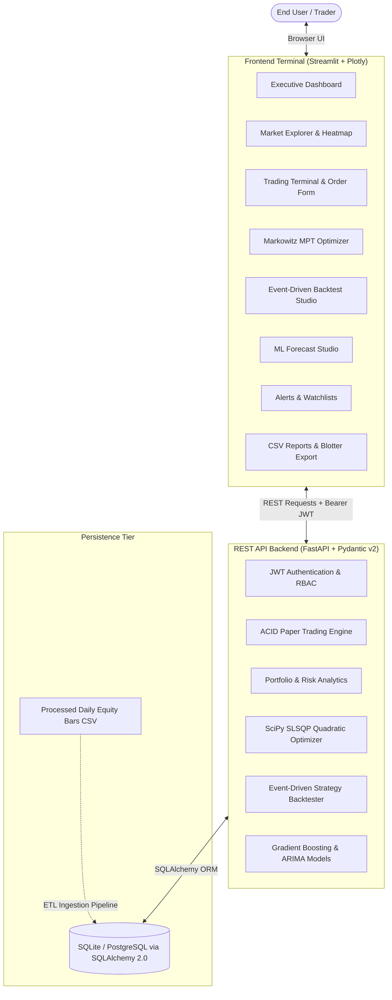

# 🌐 Portfolix — Advanced Quantitative Trading & Portfolio Platform

[](https://github.com/Arnav2407/Portfolix)
[](https://python.org)
[](https://fastapi.tiangolo.com)
[](https://streamlit.io)
[](https://plotly.com)

> **Portfolix** is a high-performance quantitative trading, portfolio risk management, and algorithmic backtesting platform. Powered by a high-throughput **FastAPI** backend and an intuitive, responsive **Streamlit** terminal, Portfolix provides an ACID paper trading engine, Markowitz Modern Portfolio Theory (MPT) quadratic optimization, event-driven backtesting, quantitative machine learning price forecasting, technical indicators, and automated rule triggers across multi-year equity market data.

---

## ⚡ Quick Start

### 1. Prerequisites
- **Python 3.11+** or **3.13**
- Virtual environment (`.venv`)

> [!IMPORTANT]
> Always activate your virtual environment before running commands:
> - **Windows PowerShell**: `& .venv\Scripts\Activate.ps1`
> - **Linux / macOS**: `source .venv/bin/activate`

---

### 2. Demo Credentials
The platform includes pre-seeded demo accounts with simulated capital, active holdings, and transaction history. You can also log in instantly using the **"Explore Demo Trader Account"** button in the Streamlit application.

| Role | Email | Password | Permissions |
|---|---|---|---|
| **Trader** | `trader@portfolix.com` | `trader123!` | Paper trading, portfolio optimization, backtesting, ML forecasting, custom alerts |
| **Admin** | `admin@portfolix.com` | `admin123!` | System access, database maintenance, API administrative operations |

---

### 3. Local Setup & Execution

#### Step 1: Environment & Dependencies
```bash
# Activate virtual environment
& .venv\Scripts\Activate.ps1   # On Windows
# source .venv/bin/activate    # On Linux/macOS

# Install dependencies (if not already installed)
pip install -e .
```

#### Step 2: Data Generation & Database Ingestion
Generate synthetic historical stock data (or bring your own CSV), populate the SQLite database, and seed default user accounts:
```bash
# 1. Generate 35,000+ daily bars across 20 NSE bluechips
python scripts/generate_sample_data.py

# 2. Ingest CSV data into SQLite database
python scripts/ingest_csv.py

# 3. Seed demo trader account and portfolios
python scripts/seed_data.py
```

#### Step 3: Start the FastAPI Backend
```bash
uvicorn backend.app.main:app --reload --host 127.0.0.1 --port 8000
```
- **Interactive Swagger Documentation**: [http://127.0.0.1:8000/docs](http://127.0.0.1:8000/docs)
- **ReDoc API Explorer**: [http://127.0.0.1:8000/redoc](http://127.0.0.1:8000/redoc)
- **Health Check**: [http://127.0.0.1:8000/api/v1/health](http://127.0.0.1:8000/api/v1/health)

#### Step 4: Start the Streamlit Frontend Terminal
In a separate terminal window (with `.venv` activated):
```bash
streamlit run app.py --server.port 8501
```
- **Streamlit Web Application**: [http://127.0.0.1:8501](http://127.0.0.1:8501)

*(Alternatively, run `make run-backend` and `make run-frontend` if `make` is installed).*

---

## 🏛️ System Architecture



---

## 🎯 Platform Modules & Capabilities

The Streamlit frontend provides a clean, user-centric financial terminal organized into 8 specialized modules:

### 1. 📊 Executive Dashboard
- **Real-Time KPIs**: Total Portfolio Value, Cash Balance, Unrealized P&L, Daily Performance, and Win Rate.
- **Historical Equity Curve**: Dynamic Plotly curve tracking portfolio net worth against benchmark index over time.
- **Asset Allocation**: Interactive donut chart breaking down equity exposure across portfolio positions.
- **Market Movers**: Real-time gainers and losers table across tracked equities.

### 2. 📈 Market Explorer
- **Interactive Technical Candlesticks**: Multi-timeframe OHLCV price action with volume bars.
- **Overlays**: Simple Moving Averages (SMA 20, SMA 50), Bollinger Bands (20, 2), and Volume-Weighted Average Price (VWAP).
- **Statistical Risk Metrics**: Annualized Volatility, 52-week High/Low range, Average True Range (ATR), and Sharpe baseline.
- **Cross-Asset Correlation Matrix**: Interactive heatmap calculating pairwise Pearson return correlations across bluechips.

### 3. ⚡ Trading Terminal
- **ACID Order Execution**: Atomic row-locking transactions preventing negative cash balances or race conditions.
- **Order Types**: `MARKET`, `LIMIT`, `STOP_LOSS`, `TAKE_PROFIT` with slippage and commission calculations.
- **Live Margin & Impact Preview**: Pre-trade cost breakdown before ticket confirmation.
- **Holdings & Execution Blotter**: Real-time Mark-to-Market (MTM) calculations, unrealized/realized P&L, and trade history.

### 4. 💼 Portfolios & MPT Optimizer
- **Tail Risk Analytics**: 95% Historical Value at Risk (VaR) and Conditional Value at Risk (CVaR / Expected Shortfall).
- **Markowitz Quadratic Optimization (SciPy SLSQP)**:
  - Generates the continuous **Efficient Frontier**.
  - **Max Sharpe Ratio**: Optimal risk-adjusted return portfolio.
  - **Min Variance**: Lowest risk/volatility allocation.
  - **Risk Parity**: Equal risk contribution allocations.
  - Generates executable rebalancing orders to transition current holdings to target weights.

### 5. 🧪 Backtest Studio
- **Event-Driven Historical Simulator**: Bar-by-bar execution with zero lookahead bias.
- **Strategies**: Dual SMA Golden/Death Cross, RSI Mean Reversion, MACD Signal Line Crossover, Momentum Breakout.
- **Interactive Performance Tearsheet**: Strategy equity curve vs. benchmark, Maximum Drawdown, Profit Factor, Win Rate, and comprehensive trade blotter logs.

### 6. 🤖 ML Forecast Studio
- **Quantitative Predictive Models**: Histogram Gradient Boosting Regressor (`HistGradientBoostingRegressor`), Ridge Regression, ARIMA, and Holt-Winters Exponential Smoothing.
- **Forward-Walk Validation**: Walk-forward cross validation evaluating RMSE, MAE, MAPE, and Directional Accuracy.
- **Interactive Forecast Visualizer**: Multi-step future price projections accompanied by 95% confidence intervals and quantitative signal indicators (`STRONG_BUY`, `BUY`, `HOLD`, `SELL`, `STRONG_SELL`).

### 7. 🔔 Alerts & Watchlists
- **Configurable Triggers**: Set price crossing, RSI overbought/oversold, and volume surge rules.
- **Alert Evaluator**: Automatic evaluation against current market data.
- **Custom Watchlists**: Track curated baskets of symbols.

### 8. 📑 Reports & Blotter
- **Data Export**: One-click direct CSV download for active portfolio holdings and audited historical execution blotters.

---

## 🌐 Production Deployment Guide

Deploying Portfolix to the public internet can be done using either a cloud PaaS or a dedicated Virtual Private Server (VPS).

### Option A: Cloud PaaS (Render / Railway + Streamlit Community Cloud)

1. **Deploy the FastAPI Backend (e.g. Render or Railway)**:
   - Create a new Web Service pointing to your GitHub repository.
   - **Build Command**: `pip install -e .`
   - **Start Command**: `uvicorn backend.app.main:app --host 0.0.0.0 --port $PORT`
   - Set environment variables:
     - `SECRET_KEY`: A secure 32+ character random string.
     - `ENVIRONMENT`: `production`
     - `CORS_ORIGINS`: `["https://your-streamlit-app.streamlit.app"]`
   - Run the initial database ingestion step via Render/Railway shell:
     - `python scripts/ingest_csv.py && python scripts/seed_data.py`

2. **Deploy the Streamlit Frontend (Streamlit Community Cloud)**:
   - Connect your GitHub repository at [share.streamlit.io](https://share.streamlit.io).
   - Set Main file path: `app.py`.
   - In **Settings > Secrets**, specify your backend URL:
     ```toml
     API_BASE_URL = "https://your-backend-service.onrender.com/api/v1"
     ```
   - Deploy! Streamlit will install dependencies from `pyproject.toml` and launch automatically.

---

### Option B: Linux VPS Deployment (Ubuntu + Nginx + Systemd)

On a Linux VPS (DigitalOcean, AWS EC2, Hetzner, Linode):

1. **Clone repository and set up virtual environment**:
   ```bash
   git clone https://github.com/Arnav2407/Portfolix.git /var/www/portfolix
   cd /var/www/portfolix
   python3 -m venv .venv
   source .venv/bin/activate
   pip install -e .
   python scripts/ingest_csv.py
   python scripts/seed_data.py
   ```

2. **Create Systemd Service for Backend** (`/etc/systemd/system/portfolix-backend.service`):
   ```ini
   [Unit]
   Description=Portfolix FastAPI Backend
   After=network.target

   [Service]
   User=www-data
   WorkingDirectory=/var/www/portfolix
   ExecStart=/var/www/portfolix/.venv/bin/uvicorn backend.app.main:app --host 127.0.0.1 --port 8000
   Restart=always

   [Install]
   WantedBy=multi-user.target
   ```

3. **Create Systemd Service for Frontend** (`/etc/systemd/system/portfolix-frontend.service`):
   ```ini
   [Unit]
   Description=Portfolix Streamlit Frontend
   After=network.target

   [Service]
   User=www-data
   WorkingDirectory=/var/www/portfolix
   ExecStart=/var/www/portfolix/.venv/bin/streamlit run app.py --server.port 8501 --server.headless true
   Restart=always

   [Install]
   WantedBy=multi-user.target
   ```

4. **Configure Nginx Reverse Proxy with SSL (Certbot)**:
   ```nginx
   server {
       server_name portfolix.yourdomain.com;

       # Streamlit UI
       location / {
           proxy_pass http://127.0.0.1:8501;
           proxy_http_version 1.1;
           proxy_set_header Upgrade $http_upgrade;
           proxy_set_header Connection "upgrade";
           proxy_set_header Host $host;
       }

       # FastAPI Backend API
       location /api/ {
           proxy_pass http://127.0.0.1:8000/api/;
           proxy_set_header Host $host;
           proxy_set_header X-Real-IP $remote_addr;
       }
   }
   ```
   Enable SSL with `certbot --nginx -d portfolix.yourdomain.com`.

---

## 🧪 Testing & Verification

### Running Quantitative & Unit Tests
```bash
& .venv\Scripts\Activate.ps1
python -m pytest tests/
```
All **17 backend tests** pass, validating authentication, ACID trading execution, risk math, SLSQP optimization, backtesting, and ML engines.

### Running End-to-End Verification
```bash
& .venv\Scripts\Activate.ps1
python scripts/verify_e2e.py
```

---

## 📁 Repository Structure

```
Portfolix/
├── backend/
│   └── app/
│       ├── core/          # Configuration, security, database session
│       ├── models/        # SQLAlchemy 2.0 ORM models (orders, portfolios, market data, users)
│       ├── schemas/       # Pydantic v2 validation schemas
│       ├── services/      # Quantitative engines (trading, risk, SLSQP optimizer, backtester, ML)
│       ├── routers/       # REST API endpoints (auth, market, orders, portfolios, backtest, ml)
│       └── main.py        # FastAPI application entrypoint
├── data/
│   └── processed/
│       └── cleaned_stock_data.csv   # Historical NSE dataset (35,000+ daily bars)
├── docs/
│   ├── data_profile.md    # Detailed data profiling & schema analysis
│   └── architecture.md    # System architecture & mathematical specifications
├── scripts/
│   ├── generate_sample_data.py # Synthetic bluechip market data generator
│   ├── ingest_csv.py      # Idempotent SQLite database ETL pipeline
│   ├── seed_data.py       # Seeds default accounts & portfolios
│   └── verify_e2e.py      # Automated E2E verification test suite
├── tests/                 # Quantitative & unit Pytest test suite
├── app.py                 # Streamlit financial workstation application
├── Makefile               # Development automation commands
├── portfolix.db           # SQLite database
├── pyproject.toml         # Python project configuration & dependencies
└── README.md              # Project documentation
```

---

## ⚖️ Disclaimer
> **IMPORTANT**: Portfolix is developed strictly for educational, research, and algorithmic simulation purposes. None of the quantitative signals, forecasts, or simulated strategies constitute financial advice. Past performance is no guarantee of future returns.
