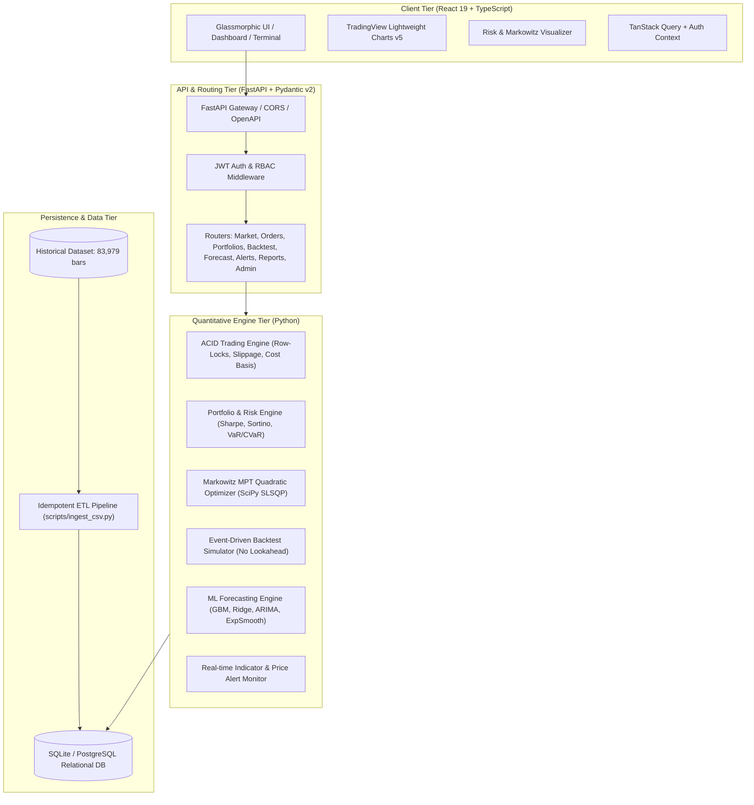
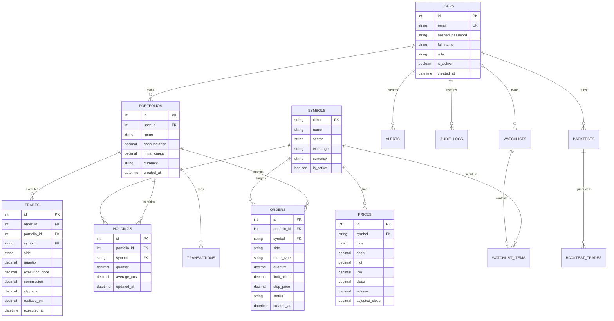

# Portfolix System Architecture & Quantitative Design

## 1. Executive Summary
**Portfolix** is a high-performance, full-stack quantitative trading and portfolio management platform built with Python (FastAPI, SQLAlchemy 2.0, NumPy, SciPy, Scikit-Learn) and React 19 (TypeScript, Vite, Tailwind CSS, TradingView Lightweight Charts). It operates on 17 years (2009–2026) of historical equity data across 20 National Stock Exchange (NSE) bluechips.

---

## 2. Core Quantitative & Engineering Engines

### 2.1. ACID Paper Trading Engine
- **Transaction Isolation & Row-Level Locking**: Uses `with_for_update()` on PostgreSQL / single-writer transactional blocks in SQLite to ensure atomic balance deduction and share allocations.
- **Strict Money Math**: Eliminates binary floating-point drift by storing all cash, execution prices, commissions, and balances as fixed-point `Numeric(18, 4)` and computing in Python via `decimal.Decimal`.
- **Execution Modeling**:
  - **Slippage**: Configurable basis-point penalty (default 5 bps = 0.05%) applied dynamically to simulate bid-ask spread and market impact.
  - **Commissions**: Configurable broker fee (default 0.03% or flat minimum).
  - **Order Types**: `MARKET`, `LIMIT`, `STOP_LOSS`, `TAKE_PROFIT`.
- **Accounting & Cost Basis**: Tracks running weighted average cost per share, updating Realized P&L on closing transactions and Unrealized MTM P&L on open positions.

### 2.2. Portfolio Analytics & Markowitz Modern Portfolio Theory (MPT)
- **Risk Metrics (Annualized with 252 trading days factor)**:
  - **Sharpe Ratio**: $\frac{R_p - R_f}{\sigma_p}$
  - **Sortino Ratio**: $\frac{R_p - R_f}{\sigma_{down}}$, where downside deviation considers only returns below the risk-free rate $R_f$.
  - **Calmar Ratio**: $\frac{CAGR}{|MaxDrawdown|}$
  - **Value at Risk (VaR 95%)**: Computed via Historical Simulation percentile and Parametric Gaussian method.
  - **Conditional VaR (CVaR / Expected Shortfall 95%)**: Mean return in the worst 5% tail.
- **Markowitz Optimization (SciPy `SLSQP`)**:
  - Solves $\min_w \frac{1}{2} w^T \Sigma w$ subject to $\sum w_i = 1$ and $w_i \ge 0$ (no short sales).
  - Generates the continuous **Efficient Frontier** across target return ranges.
  - Computes **Maximum Sharpe Ratio Portfolio**, **Minimum Variance Portfolio**, and **Risk Parity (Equal Risk Contribution)** weights.
  - Computes exact rebalancing trade orders from current holdings to target optimal weights.

### 2.3. Event-Driven Strategy Backtesting Engine
- **Bar-by-Bar Simulation**: Iterates forward chronologically across daily OHLCV bars with strictly **zero lookahead bias**.
- **Strategies Supported**:
  - Dual SMA/EMA Golden Cross / Death Cross
  - RSI Overbought / Oversold Mean Reversion with Trend Filter
  - MACD Signal Line Crossover
  - Multi-Timeframe Price Momentum & Breakout
- **Parameter Optimization**: Grid search across parameter spaces (e.g. fast/slow window lengths) to identify optimal parameter sets.
- **Analytics Output**: Equity curve time series, Drawdown series, monthly return heatmap matrix, trade log with individual P&L and duration, Sharpe, CAGR, Profit Factor, Win Rate, and Average Trade Return.

### 2.4. Quantitative ML Forecasting Engine
- **Feature Engineering**: Generates multi-lag returns ($t-1, t-2, t-5, t-10, t-21$), rolling volatility, RSI(14), MACD, and Bollinger %B.
- **Models**:
  - Gradient Boosted Trees (`HistGradientBoostingRegressor`)
  - Regularized Linear Ridge Regression (`Ridge`)
  - Auto-Regressive Integrated Moving Average (`ARIMA(p,d,q)`)
  - Holt-Winters Exponential Smoothing (`ExponentialSmoothing`)
- **Strict Validation**: Time-series cross-validation / rolling forward split (never random k-fold shuffle to prevent future data leakage).
- **Signal Generation**: Maps forecasted returns and confidence intervals into `STRONG_BUY`, `BUY`, `HOLD`, `SELL`, or `STRONG_SELL` with confidence scores and explicit model performance metrics (RMSE, MAE, MAPE, Directional Accuracy).

---

## 3. Database Schema

---

## 4. Security, RBAC & Compliance
1. **Authentication**: JWT token mechanism using Cryptographic `HS256` or `RS256` signatures, with token expiration, auto-refresh headers, and salted `bcrypt` password hashes.
2. **Role-Based Access Control (RBAC)**:
   - `admin`: Full system control, user provisioning, database health metrics, audit logs.
   - `trader`: Portfolio creation, paper order execution, backtest studio, ML forecasting studio, custom alerts.
   - `viewer`: Read-only market data exploration, charting, and indicator inspection.
3. **Mandatory Disclaimer**: Displayed prominently across the frontend footer, navigation modals, API swagger docs, and PDF/CSV exports clarifying that all signals, analytics, and simulated trades are strictly educational and not financial advice.
